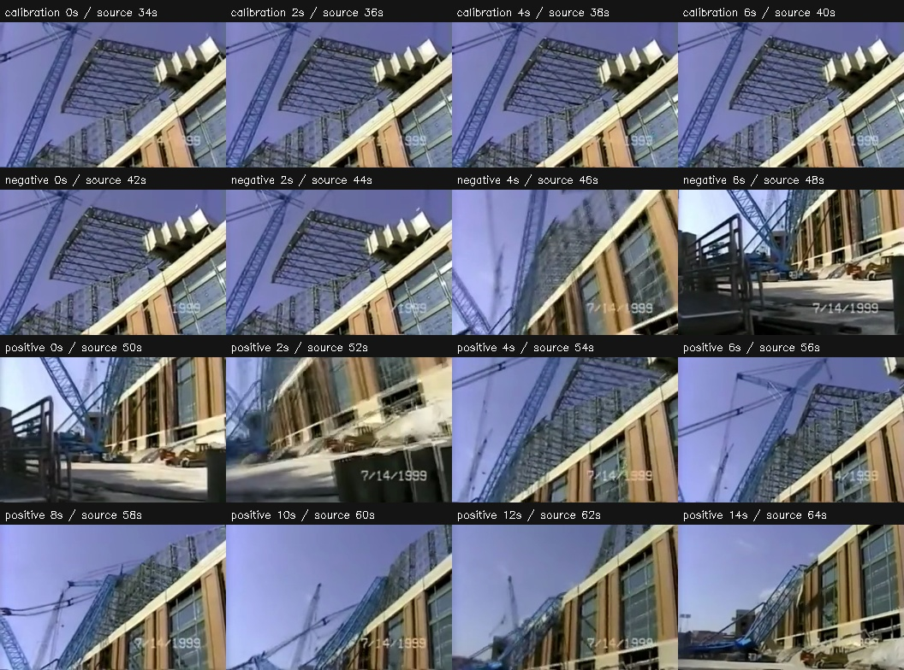
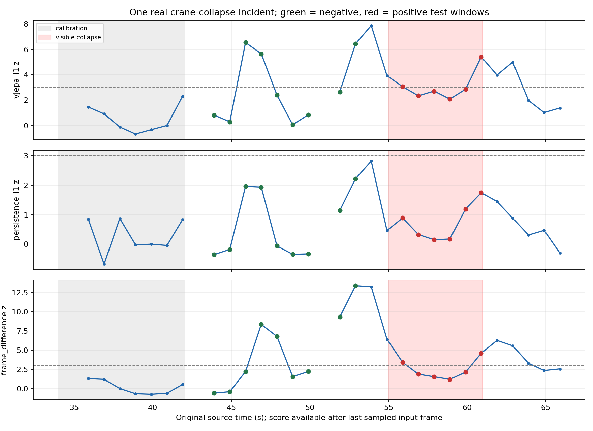

# 真实施工危险正样本：Big Blue 倒塌案例实测

本报告为新增主实验；原有合成扰动实验继续保留在 [VALIDATION.md](VALIDATION.md)，二者不混算。日期：2026-10-30。

## 视频与逐段真值

选用 [Big Blue crane collapse at Miller Park](https://commons.wikimedia.org/wiki/File:Big_Blue_crane_collapse_at_Miller_Park.webm)。Commons 标记为未具名 OSHA 雇员拍摄的美国联邦政府公共领域作品；[OSHA 案例页](https://obis.osha.gov/dcsp/success_stories/compliance_assistance/abbott/abbott_casestudies/slide30.html)说明其为施工中的真实起重机倒塌。已核对源文件 SHA1 `73fc5052f91beddbcfc18a8c9988cb00042e1886` 与 Commons 公开记录一致。

下载原片后，在读取新视频的模型分数前，人工查看原始帧并固定 [评估方案](../docs/real_hazard_protocol.md)和 [manifest](../data/real_hazard_manifest.json)。源 SHA256：`fa4c0de9e1f7e5961d10fdd85e636b10dc99acb5fa41e5f7b0e3059426c71e4e`。

| 切片 | 源时间 | 时长 | 用途 |
|---|---|---:|---|
| big_blue_calibration.mp4 | 34–42 s | 8 s | 无可见倒塌的校准片段 |
| big_blue_negative.mp4 | 42–50 s | 8 s | 无可见倒塌的测试对照，包含运镜 |
| big_blue_positive.mp4 | 50–66 s | 16 s | 包含真实失稳/倒塌过程的危险正样本 |

正片内 5–11 秒（源 55–61 秒）标为可见失稳/倒塌，0–3 秒为无可见倒塌，3–5 秒过渡和 11–16 秒事后画面排除统计。边界约 ±0.5 秒不确定性；“无可见倒塌”不表示工况安全。三个片段没有共享源帧，只包含 **1 个独立真实事故**。未插入合成危险或拼接不同事件。

## 设置和实际检查

沿用真实预训练 V-JEPA 2 ViT-L（`meta-vitl-5346856ec9df6948`）、MPS/float32、8 fps、16 帧窗口、8 帧步长、pad、LayerNorm 后 L1 和 z≥3。仅事前 7 个窗口估计每种方法自己的正常基线，不训练、不用测试标签调阈值。

分类要求未来半窗全部采样帧落在已标正或负区间；跨边界、过渡和事后窗口保存为 excluded。测试纳入 15 个窗口，排除 7 个；正负数量见表。未来半窗才定义评分所对应的事件范围，标签只用于推理后评估。

主分析程序分别生成了三份 CSV、图像及正/负片段复核视频；评估重算 V-JEPA 分数与主程序最大绝对差为 `1.1920929e-07`。评估阶段耗时 12.18 秒，不含三次主分析、模型加载或视频编码。

## 固定方案结果

| 方法 | AUROC | TP | FP | TN | FN | Precision | Recall | FPR |
|---|---:|---:|---:|---:|---:|---:|---:|---:|
| vjepa_l1 | 0.593 | 2 | 3 | 6 | 4 | 0.400 | 0.333 | 0.333 |
| persistence_l1 | 0.593 | 0 | 0 | 9 | 6 | 未定义 | 0.000 | 0.000 |
| frame_difference | 0.370 | 2 | 4 | 5 | 4 | 0.333 | 0.333 | 0.444 |

`persistence_l1` 是保持最后上下文 tubelet 的潜特征基线；`frame_difference` 是平均相邻帧像素差。全部指标和 F1/平衡准确率见 [metrics.csv](real_hazard/metrics.csv)。AUROC 高不保证固定阈值误报低，且不同方法原始量纲不同。

V-JEPA 2 残差对本次事故：**检出**。首次检出窗口的最后输入帧相对可见倒塌起点的时间差：**0.90 秒**。该值不含推理开销；事前高分按负例误报计，不能称为事故提前预警。

窗口 Recall=33.3%、Precision=40.0%、FPR=33.3%、平衡准确率=0.500。本次事件被命中不代表方法可靠；尤其运镜产生了明显的高分误报。事件数只有 1，不能由“本例检出”报告普遍的 100% 事故检出率。

## 能支持的结论和局限

这次已实际使用包含真实危险正样本的短视频完成完整分析和定量评估。应同时根据上表的检出和误报评价方法，不能只展示最高热图或只报 AUROC。

独立事故数仅 1，所有测试窗口来自同一录像并有相邻依赖，分辨率仅 352×262。手持运镜与倒塌运动混杂，校准段短，人工边界未经第二位标注者复核。当前结果不能支持跨工地泛化准确率、施工规则识别或事故前危险预判。负样本的运镜和事后排除区间均记录在原始分数表，未隐藏失败窗口。

此前合成扰动的结果和不足不变；它们是补充的软件/敏感性实验。模型权重、主分析方法和阈值没有因本案例结果改动。

复现：`bash scripts/run_real_hazard.sh`。原始视频、派生切片和模型保存在本机；来源、权利说明及编辑记录见 [ATTRIBUTION.md](../docs/ATTRIBUTION.md)。
