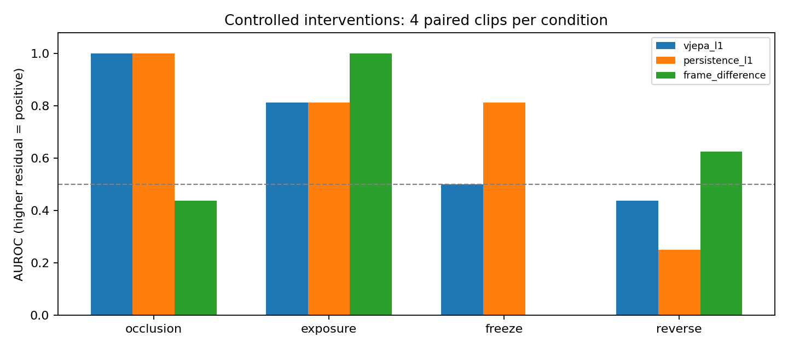
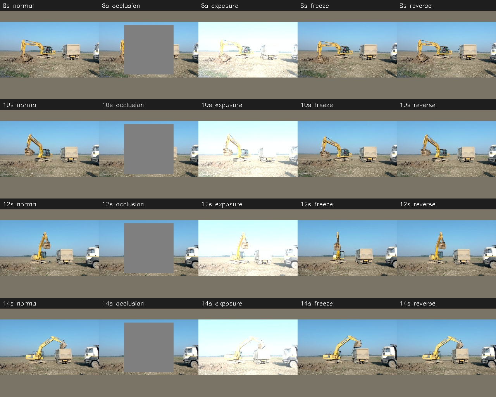
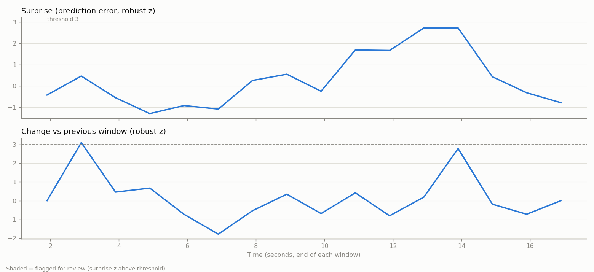

# 本机 V-JEPA 2 工地视频实验记录（合成扰动补充实验）

新增真实施工危险正样本的主实验见 [REAL_HAZARD_VALIDATION.md](REAL_HAZARD_VALIDATION.md)。本报告仅记录原有正常视频和合成扰动，以下“无真实事故标签”的范围指本补充子实验。

实验日期：2026-10-30。以下数值来自真实预训练模型在本机运行产生的文件，不是示例输出。

## 条件与来源

- MacBook Pro，Apple M4 Max，40 核 GPU，64 GB 内存；macOS 26.1。
- 推理设备 `mps`，精度 `float32`，PyTorch 2.8.0，Transformers 4.57.1。
- 权重来源：`Meta official checkpoint`。标识：`meta-vitl-5346856ec9df6948`；本地 safetensors SHA256：`10623f51b674bfc07371ff30283426f452c724e7512fd649fa8287965499a5bc`。
- 视频：KEmel49 的 [Excavator digging land and loading truck](https://commons.wikimedia.org/wiki/File:Excavator_digging_land_and_loading_truck.webm)，CC BY-SA 4.0；视频 SHA256：`40b48f4a0a29f58416023ecd32453060b361b707c62c782887845217c99c4d8f`。
- 采样 8 fps，16 帧/窗，256×256 均值色补边，无微调。
- 校准使用 `[0,8)` 秒的 7 个正常窗口；测试每类 4 个互不重叠的窗口，起点为 [8.0, 10.0, 12.0, 14.0] 秒。校准和测试不共享帧。
- 原视频没有经核实的事故正例。正样本是确定性编辑的画面/时序扰动，详见[预定义方案](../docs/validation_protocol.md)。
- 最终协议为 `v2-exposure-preserves-padding`：曝光编辑只作用于原画面，预处理补边保持不变。初次包含补边增亮的实现已修正；初次结果完整保留在 `validation_v1_padding_exposure/`，未作为最终指标。

## 预训练模型的未来输入隔离检查

保持前半窗不变，修改未来半窗后，预测向量最大绝对差为 **0**；目标表征平均绝对变化为 **0.600121**。前者低于预先设定的 `1e-5` 容差，符合预测器没有使用未来像素的要求。

这不把离线教师目标变为因果表征。目标编码器仍可见完整窗口，分数应解释为掩码潜表征残差。

## 全部受控结果

AUROC 以“分数越高越像被编辑”为方向；0.5 为随机排序参考。配对胜率为编辑后分数高于同窗原版的比例。固定阈值使用校准集 median/MAD 得到的 z≥3，没有用测试分数调参。FPR 是相同的未编辑测试窗口误报率。

| 扰动 | 方法 | AUROC | 配对平均增量 | 配对胜率 | TPR z≥3 | FPR z≥3 |
|---|---|---:|---:|---:|---:|---:|
| 中央遮挡 | vjepa_l1 | 1.000 | +0.048832 | 100.0% | 100.0% | 25.0% |
| 中央遮挡 | persistence_l1 | 1.000 | +0.069614 | 100.0% | 100.0% | 0.0% |
| 中央遮挡 | frame_difference | 0.438 | -0.001125 | 25.0% | 50.0% | 75.0% |
| 全局增亮 | vjepa_l1 | 0.812 | +0.009743 | 100.0% | 75.0% | 25.0% |
| 全局增亮 | persistence_l1 | 0.812 | +0.009576 | 100.0% | 25.0% | 0.0% |
| 全局增亮 | frame_difference | 1.000 | +0.008674 | 100.0% | 100.0% | 75.0% |
| 未来冻结 | vjepa_l1 | 0.500 | -0.002521 | 50.0% | 0.0% | 25.0% |
| 未来冻结 | persistence_l1 | 0.812 | +0.014302 | 75.0% | 0.0% | 0.0% |
| 未来冻结 | frame_difference | 0.000 | -0.007752 | 0.0% | 0.0% | 75.0% |
| 未来逆序 | vjepa_l1 | 0.438 | -0.003168 | 25.0% | 25.0% | 25.0% |
| 未来逆序 | persistence_l1 | 0.250 | -0.004354 | 0.0% | 0.0% | 0.0% |
| 未来逆序 | frame_difference | 0.625 | +0.001057 | 100.0% | 75.0% | 75.0% |

方法：`vjepa_l1` 为预训练 predictor 的残差；`persistence_l1` 为复制最后一个过去 tubelet 的潜特征残差；`frame_difference` 为模型视野的相邻帧 RGB 差分平均值。三种方法各用自己的正常校准统计。

## 逐项解释

- **中央遮挡**：V-JEPA 残差 AUROC=1.000，高于本次 0.5 排序参考；固定阈值检出 100.0%。
- **全局增亮**：V-JEPA 残差 AUROC=0.812，高于本次 0.5 排序参考；固定阈值检出 75.0%。曝光是摄像头干扰，即使能检出，也不能作为识别危险施工行为的证据。
- **未来冻结**：V-JEPA 残差 AUROC=0.500，等于本次 0.5 排序参考；固定阈值检出 0.0%。该条件显示时序变化可能漏检，不能默认世界模型残差会识别所有时序异常。
- **未来逆序**：V-JEPA 残差 AUROC=0.438，低于本次 0.5 排序参考；固定阈值检出 25.0%。该条件显示时序变化可能漏检，不能默认世界模型残差会识别所有时序异常。

## 原视频的离线分析

完整源视频产生 **16 个窗口**、**0 段复核事件**；分析阶段耗时 **9.59 秒**，约 **1.67 窗口/秒**。该耗时不含模型下载/加载及复核视频编码；完整视频采用自身统计归一化，属于描述性分析。这里的复核事件没有事故标签，不能计算真实施工事故 precision/recall。

另用 `[0,8)` 秒的正常基线分析后续视频，真实模型的外部基线管线产生 8 个窗口和 1 段复核事件。其中约 12–14 秒为正常回转阶段，说明动作阶段变化也可能触发高残差。该流程的窗口步长为 1 秒，与上表不重叠 2 秒测试窗的统计口径不同。

受控验证耗时 10.18 秒（不含模型加载）。复核视频和 Top-K 图在 `outputs/excavator/`；分数、特征、事件及运行元数据一并保留。

## 结论与不能推出的结论

已验证本机可以使用真实 V-JEPA 2 权重完成视频抽帧、过去独立编码、未来潜特征预测、残差打分、可视输出和固定方案的对照评估。检测效果必须逐项按上表判断；代码运行成功不代表事故识别有效。

遮挡条件下 predictor 和特征保持基线的 AUROC 相同，后者的固定阈值误报更低；冻结和逆序未获得可靠检出。当前结果没有证明 predictor 残差整体优于简单基线。热图中的补边区域也可能有较高残差，当前标量评分包含这些 patch，不宜作物理位置的直接解释。

本实验只有一个来源，每类 4 个配对正样本；动作阶段、背景和时序相关，正负样本也有配对依赖。没有独立工地、独立标注者、真实异常正例或统计显著性结论。不能报告泛化准确率、事故检出率、施工违规识别能力或整体优于简单基线。

若用于研究结论，下一步应获取依法可用的多机位正常/真实异常视频，独立定义危险事件标签，按工地/日期分离训练校准与测试，并与帧差、光流、目标检测/跟踪及经过训练的异常检测器公平比较。光照、遮挡、镜头移动需要单列干扰集。

原视频和包含其画面的派生图像按 CC BY-SA 4.0 署名，见[素材说明](../docs/ATTRIBUTION.md)。
